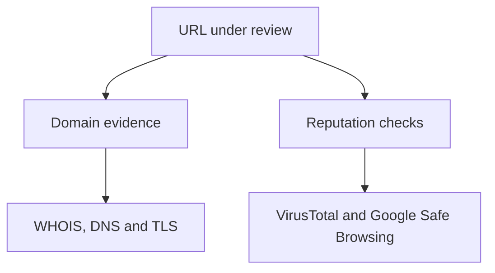

# Alan Kolett

**Security field notes**　/　Pune, India

I study cybersecurity at Symbiosis Skills & Professional University. Give me a suspicious link and my first question is *what evidence would make me trust a warning about it?* That question is a good way into my work.

**Open to cybersecurity internships in Pune or remotely.** [Get in touch on LinkedIn ↗](https://www.linkedin.com/in/alan-kolett-00019325b/)

---

## Inside PhishGuard Pro

A QR code hides the destination. An email gives you context that a bare URL leaves out. [PhishGuard Pro](https://github.com/alankolett/PhishGuard-Pro) accepts all three inputs. Its FastAPI backend brings together domain checks, reputation services and an explanation of the findings.

❮ **Trace a link through the project** ❯

**A detail worth discussing**　A valid TLS certificate tells you the connection is encrypted. It tells you little about whether the person asking for your password is trustworthy. That distinction is why I’m interested in tools that explain the evidence behind a warning.

## Two more questions from my repositories

| Question | Where to look |
| :--- | :--- |
| Can patterns in network traffic help anticipate an attack? | [**Sentinel**](https://github.com/alankolett/Sentinel) explores network attack forecasting for Smart India Hackathon problem statement 26153. Start with the evaluation section and the choice of baseline. |
| When reception moves a queue forward, how does a patient see the same update? | [**MediQueue**](https://github.com/alankolett/MediQueue) uses Socket.IO to synchronize clinic and patient views. It’s a good place to see the software engineering side of my work. |

<b>Explore my AI and retrieval projects</b>

- [FinSense AI](https://github.com/alankolett/FinSense-AI) grounds financial answers in retrieved material.
- [TalentGraph](https://github.com/alankolett/TalentGraph) explores retrieval, reranking and evaluation.

## Beyond the repositories

I’m a **Cloud Security & Innovation Associate with the AWS Student Builder Group at SSPU**. Previously, I completed cybersecurity internships at **NexLevr** and **ShadowFox**, and a software internship at **Mesmerise Soft-Tech**.

I hold the **Certified Network Security Practitioner** and **Certified Social Engineering Defense Practitioner** credentials. My [LinkedIn profile](https://www.linkedin.com/in/alan-kolett-00019325b/) has the issuers, dates and internship history.
